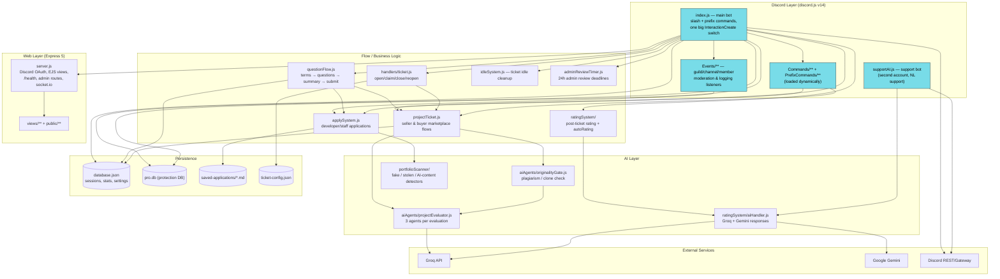
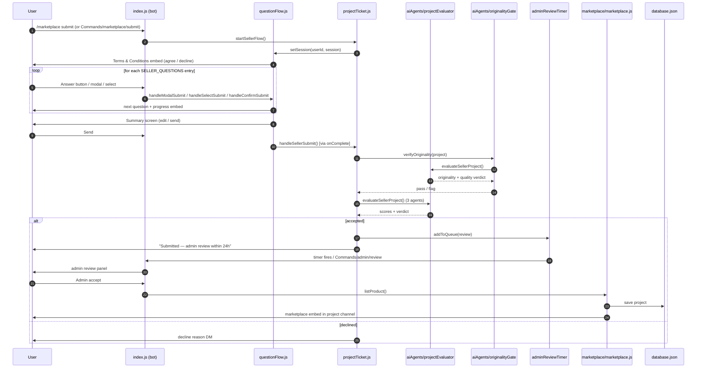
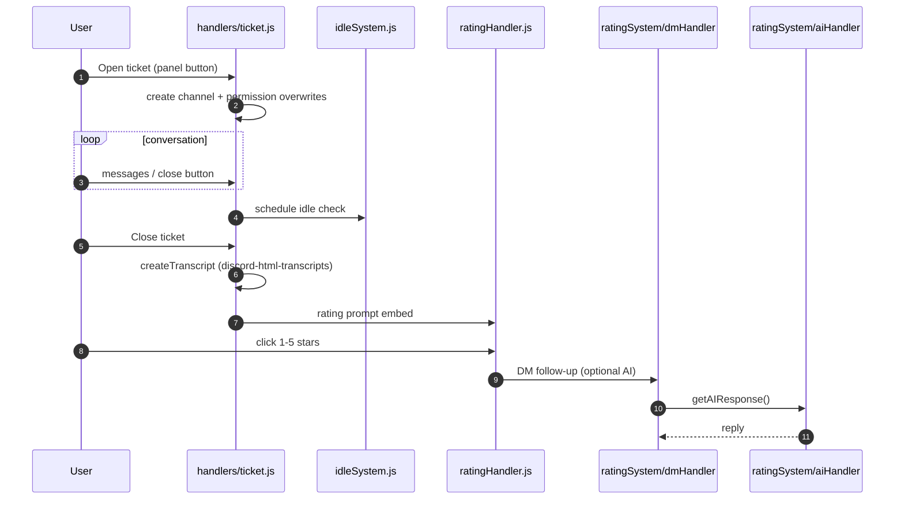
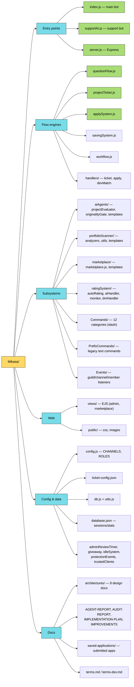

# Mikasa — Codebase Graphs

Generated from the repository source (static `require()` analysis + entry-point inspection).

> **Note:** No MCP graph server or graph skill is registered in this environment, so these
> diagrams were generated by direct source analysis rather than by invoking an external tool.

---

## 1. Module Dependency Graph

Direct `require()` relationships between local modules (npm packages omitted).

```mermaid
flowchart TD
    classDef entry fill:#ffd866,stroke:#333,stroke-width:2px,color:#000
    classDef core fill:#a9dc76,stroke:#333,color:#000
    classDef flow fill:#78dce8,stroke:#333,color:#000
    classDef ai fill:#ab9df2,stroke:#333,color:#000
    classDef store fill:#ff6188,stroke:#333,color:#000
    classDef leaf fill:#fcfcfa,stroke:#999,color:#000

    subgraph flows ["Session / flow engines"]
        questionFlow["questionFlow.js<br/>(session engine)"]:::flow
        applySystem["applySystem.js<br/>(dev/staff apps)"]:::flow
        projectTicket["projectTicket.js<br/>(seller/buyer flows)"]:::flow
        savingSystem["savingSystem.js"]:::flow
    end

    subgraph aiLayer ["AI layer"]
        projectEvaluator["aiAgents/projectEvaluator.js"]:::ai
        originalityGate["aiAgents/originalityGate.js"]:::ai
        aiHandler["ratingSystem/aiHandler.js"]:::ai
    end

    subgraph dataLayer ["Data / persistence"]
        database[("database.json + pro.db")]:::store
    end

    index["index.js<br/>(main entry)"]:::entry
    supportAI["supportAI.js<br/>(2nd bot account)"]:::entry
    server["server.js<br/>(Express + EJS + socket.io)"]:::entry

    index --> questionFlow
    index --> projectTicket
    index --> applySystem
    index --> ticketHandler["handlers/ticket.js"]
    index --> applyHandler["handlers/apply.js"]
    index --> db
    index --> utils
    index --> ticketLogger
    index --> ratingHandler
    index --> giveaway
    index --> idleSystem
    index --> protectionEvents
    index --> adminReviewTimer
    index --> ratingSystem["ratingSystem/monitor + dmHandler"]
    index --> server
    index --> loadCommands["Commands/** (dynamic load)"]
    index --> loadEvents["Events/** (dynamic load)"]
    index --> loadPrefix["PrefixCommands/** (dynamic load)"]

    questionFlow --> savingSystem
    questionFlow --> utils
    questionFlow -. "onComplete" .-> applySystem
    questionFlow -. "onComplete" .-> projectTicket

    applySystem --> savingSystem
    applySystem --> questionFlow
    applySystem --> config
    applySystem --> utils
    applySystem --> portfolioScanner

    projectTicket --> questionFlow
    projectTicket --> config
    projectTicket --> utils
    projectTicket --> db
    projectTicket --> trustedClients
    projectTicket --> adminReviewTimer
    projectTicket --> projectEvaluator
    projectTicket --> originalityGate
    projectTicket --> marketplace
    projectTicket --> marketplaceEmbed["marketplace/templates/marketplaceEmbed"]

    ticketHandler --> projectTicket
    ticketHandler --> utils
    applyHandler --> questionFlow
    applyHandler --> db
    applyHandler --> adminReviewTimer
    applyHandler --> projectEvaluator
    applyHandler --> trustedClients
    applyHandler --> devMatch["handlers/devMatch.js"]
    devMatch --> projectTicket

    marketplace --> projectEvaluator
    originalityGate --> projectEvaluator
    projectEvaluator --> groq["groq-sdk / @google/generative-ai"]

    portfolioScanner --> fakeDetector["analyzers/fakeDetector"]
    portfolioScanner --> stolenDetector["analyzers/stolenDetector"]
    portfolioScanner --> aiDetector["analyzers/aiDetector"]
    portfolioScanner --> legitimacyCheck["analyzers/legitimacyCheck"]
    portfolioScanner --> scoring["utils/scoring"]
    portfolioScanner --> preprocessor["utils/preprocessor"]
    portfolioScanner --> adjustments["utils/adjustments"]
    fakeDetector --> keywordSets["utils/keywordSets"]
    stolenDetector --> keywordSets
    aiDetector --> keywordSets
    adjustments --> keywordSets
    keywordSets --> urlChecker["utils/urlChecker"]

    savingSystem --> config
    savingSystem --> utils
    db --> utils
    utils -. "lazy" .-> db

    supportAI --> aiHandler["ratingSystem/aiHandler"]
    supportAI --> utils
    aiHandler --> serverContext["ratingSystem/serverContext"]
    dmHandler["ratingSystem/dmHandler"] --> aiHandler
    ratingSystem --> aiHandler

    server --> config
    server --> utils
    server --> views["views/** (EJS)"]

    loadCommands --> utils
    loadPrefix --> utils
    giveaway --> utils
    ticketLogger --> ticketConfig["ticket-config.json"]
    config["config.js"]:::core
    utils["utils.js"]:::core
    db["db.js"]:::store
    trustedClients["trustedClients.js"]:::store
    adminReviewTimer --> utils
    protectionEvents --> db

    db --> database
    utils --> database
```

---

## 2. System Architecture

---

## 3. Interaction Flow — Seller Submission (sequence)

End-to-end flow of a marketplace seller submission, the longest path through the system:

Ticket → rating flow (shorter path):

---

## 4. Directory / File Tree Graph

---

## Key observations

- **`index.js` is a god module**: ~1000+ lines, dynamically loads `Commands/`, `Events/`, `PrefixCommands/`, and routes every interaction through one `InteractionCreate` switch.
- **Circular dependencies exist** (handled via lazy `require()`): `questionFlow ↔ projectTicket`, `questionFlow ↔ applySystem`, `utils ↔ db`.
- **`questionFlow.js` is the shared session engine** used by all four flows (developer, staff, seller, buyer); completion is wired via `makeOnComplete(type)` callbacks.
- **Two Discord clients** run from one codebase: `index.js` (main) and `supportAI.js` (support account), sharing `ratingSystem/aiHandler`.
- **AI is centralized** in `aiAgents/projectEvaluator.js` (Groq) with `originalityGate` wrapping it for plagiarism checks.
